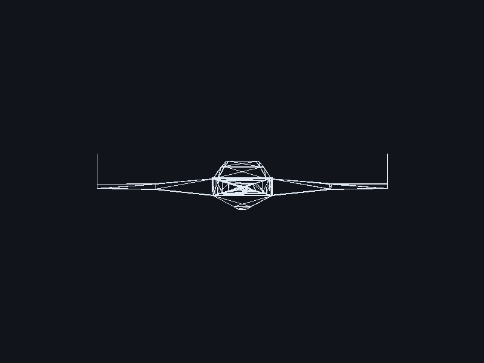
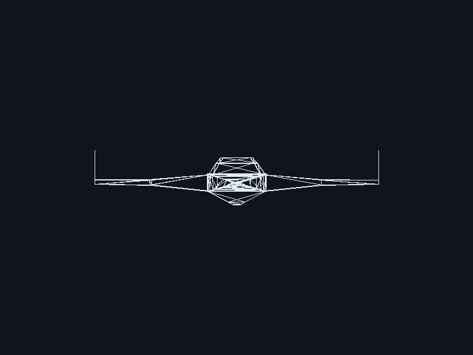
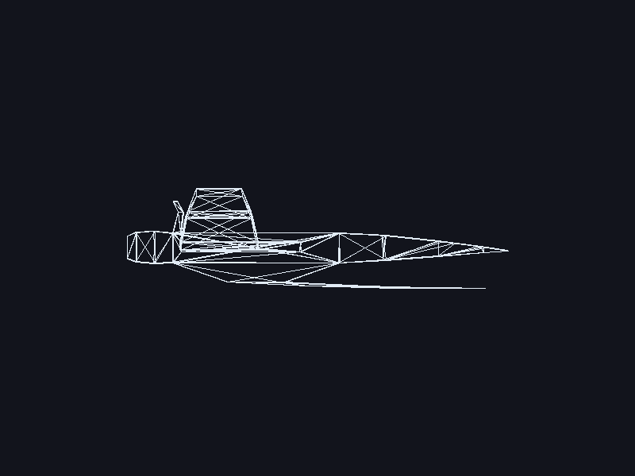
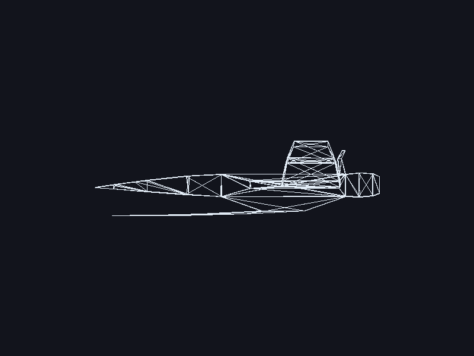
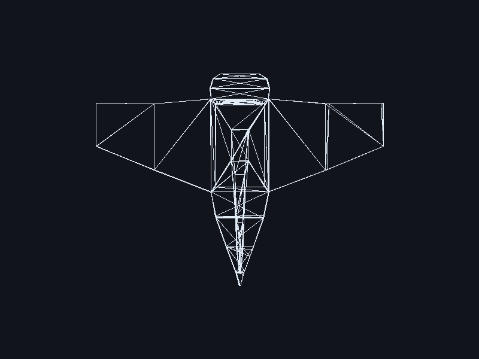
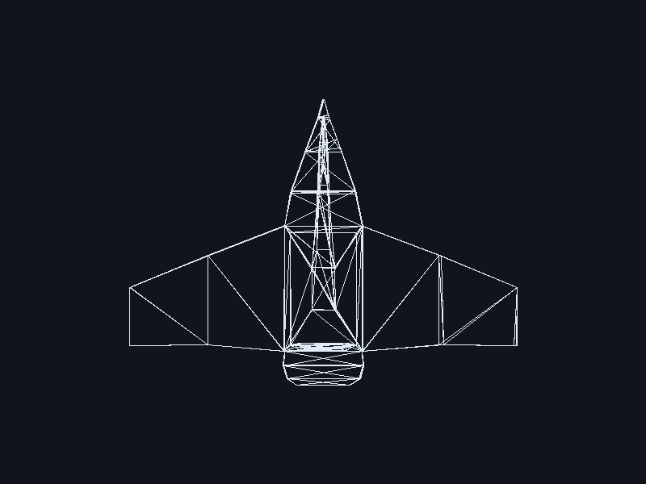

# OBJ Wireframe Renderer

Proyecto 1, Parte 1 de Gráficas por Computadora: **dibujando un modelo OBJ**.
Carga `Untitled.obj` y lo dibuja en wireframe con un rasterizador propio en
Rust: cada línea se dibuja píxel por píxel en un framebuffer en memoria, y
raylib solo se usa para abrir la ventana, subir ese framebuffer como textura
y exportar el PNG.



## Vistas

`--screenshot` genera además el modelo visto desde los otros cinco lados.
Cada vista descarta un eje distinto (la frontal descarta z); la transformación
es la misma: bounding box, escala uniforme al ~80% del lado menor, centrado e
inversión de y.

| Atrás | Izquierda | Derecha |
| --- | --- | --- |
|  |  |  |

| Arriba | Abajo |
| --- | --- |
|  |  |

Al ser wireframe sin ocultar aristas, la vista trasera es el reflejo de la
frontal y, como la nave es simétrica, se ven casi iguales.

## Requisitos

- Rust estable con soporte para edition 2024 (1.85 o superior).
- CMake y un compilador de C (en Windows, Visual Studio Build Tools), que
  `raylib-sys` necesita para compilar raylib 6.0.0.

## Comandos

```bash
cargo build --release                          # compilar
cargo run --release                            # abrir la ventana (1-6 cambian la vista, ESC cierra)
cargo run --release -- --screenshot            # regenerar las capturas de evidence/ sin ventana
cargo test -- --nocapture                      # tests (muestra vértices y triángulos)
```

### Controles de la ventana

| Tecla | Vista |
| --- | --- |
| `1` | Frente |
| `2` | Atrás |
| `3` | Izquierda |
| `4` | Derecha |
| `5` | Arriba |
| `6` | Abajo |
| `ESC` | Cerrar |

También funcionan las teclas 1-6 del teclado numérico. Al cambiar de vista el
modelo se vuelve a rasterizar en el framebuffer y se actualiza la textura; la
vista actual se muestra en el título de la ventana.

## Pipeline

```
Archivo OBJ → vértices + índices → triángulos → líneas → píxeles → pantalla
```

| Paso | Archivo / función | Qué hace |
| --- | --- | --- |
| Archivo OBJ → vértices + índices | `src/obj.rs` · `Obj::load` | Lee las líneas `v` (a `vertices: Vec<Vector3>`) y `f` (a `faces: Vec<[usize; 3]>`). Soporta `1`, `1/2`, `1//3`, `1/2/3` e índices negativos; ignora `vt`, `vn` y materiales. |
| índices → triángulos | `src/obj.rs` · `Obj::parse` | Caras de más de 3 vértices se triangulan en abanico desde el primer vértice. |
| triángulo → 2D | `src/transform.rs` · `ScreenTransform::fit` / `apply` | Sin perspectiva: en la vista frontal usa solo x e y (`View` elige los ejes de las demás vistas), escala uniforme para que el lado mayor del bounding box ocupe ~80% del lado menor de la ventana, centra el modelo e invierte y. |
| recorrido de caras | `src/render.rs` · `render` | Por cada cara: toma sus 3 índices, busca los 3 vértices, los transforma a 2D y llama a `triangle`. |
| triángulos → líneas | `src/triangle.rs` · `triangle` | Dibuja las 3 aristas con `line`. |
| líneas → píxeles | `src/line.rs` · `line` | Algoritmo de Bresenham propio; cada píxel va a `Framebuffer::point`. |
| píxeles → pantalla | `src/framebuffer.rs` · `Framebuffer` | Buffer de color propio con `clear`, `point` (con bounds-check), color actual, `to_image` y `save_png`. |
| ventana / captura | `src/main.rs` · `run_window` / `screenshot` | Ventana de 800x600 que muestra el framebuffer como textura (teclas 1-6 para cambiar de vista), o guarda `evidence/screenshot.png` y las capturas de cada vista. |

## Modelo

`Untitled.obj` (nave exportada desde Blender):

- **356 vértices**
- **462 caras**, que trianguladas dan **933 triángulos**

## Nota sobre raylib

No se usa ninguna función de raylib para cargar ni dibujar el modelo
(`LoadModel`, `DrawModel`, `DrawTriangle`, `DrawLine`, `ImageDrawPixel`, etc.).
El parser OBJ, la transformación, las líneas y los triángulos son código propio
que escribe directamente en el framebuffer.
